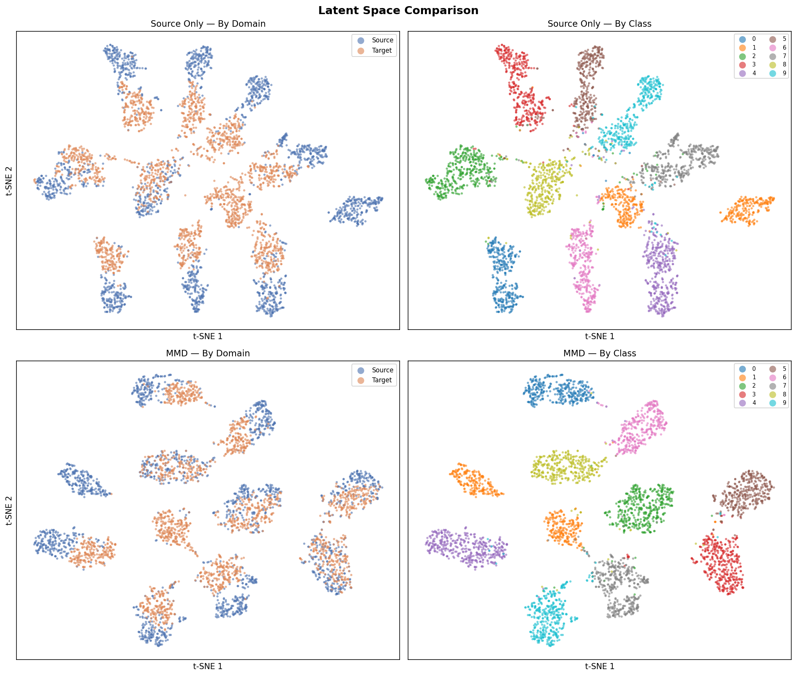
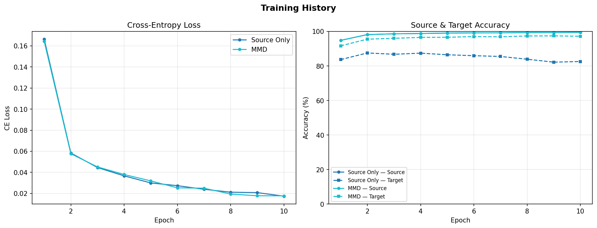
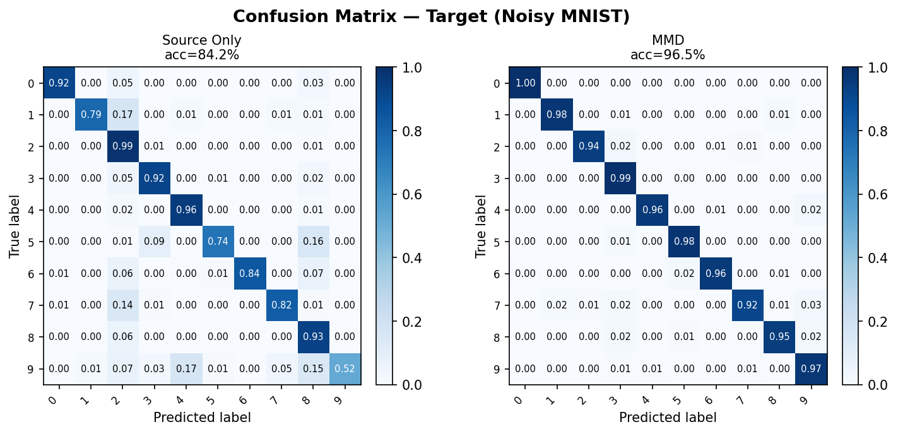
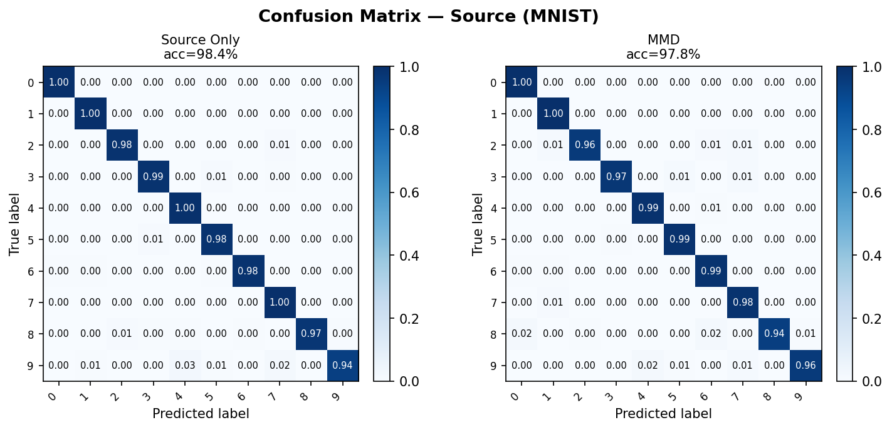
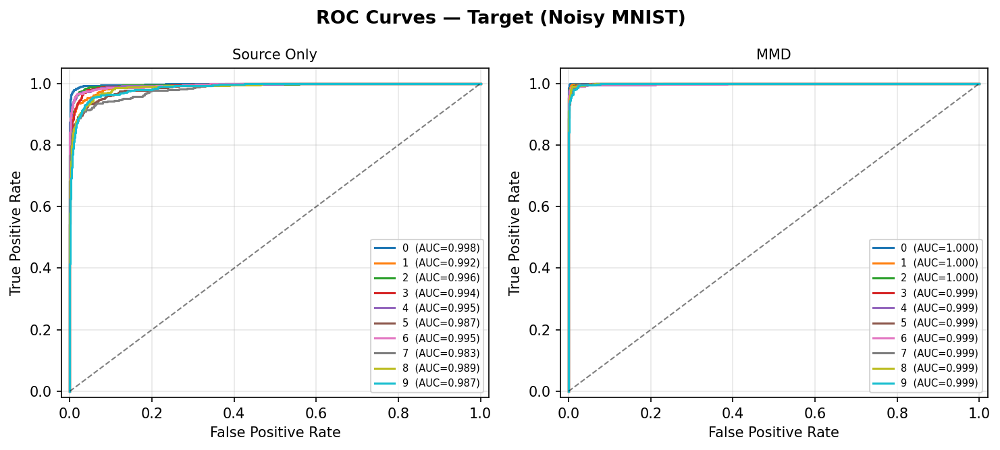
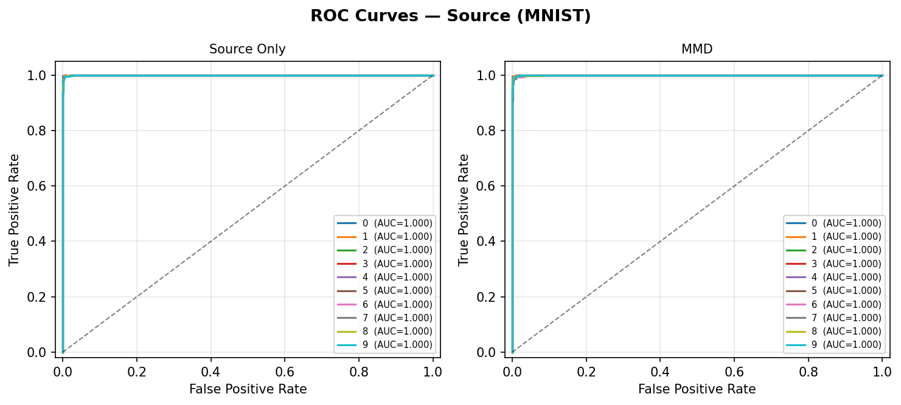

# Diagnostics

`shiftkit.diagnostics` provides visualisation tools for inspecting latent spaces, classification performance, and training dynamics.

---

## plot_latent_space

Encode samples from source and target loaders, project to 2-D, and plot two panels:

- **Left** — coloured by domain (source = blue, target = orange)
- **Right** — coloured by class label (tab10 for ≤10 classes; tab20 or HSV colours with varied markers for more; unlabelled samples in grey)

Three projection methods are available via the `projection` parameter:
[t-SNE](#t-sne), [Isomap](#isomap), and [UMAP](#umap).

```python
from shiftkit.diagnostics import plot_latent_space

# t-SNE (default)
fig = plot_latent_space(
    model=model,
    source_loader=test_src,
    target_loader=test_tgt,
    max_samples=2000,
    projection="tsne",
    title="CNN + MMD",
    save_path="outputs/latent_space.png",
    show=False,
)

# Isomap
fig = plot_latent_space(model, test_src, test_tgt,
                        projection="isomap", n_neighbors=10)

# UMAP
fig = plot_latent_space(model, test_src, test_tgt,
                        projection="umap", n_neighbors=15, min_dist=0.1)
```

### Parameters

| Parameter | Type | Default | Description |
|-----------|------|---------|-------------|
| `model` | `nn.Module` | — | Trained model with `.encode()` method |
| `source_loader` | `DataLoader` | — | Source domain DataLoader (tensor, PyG graph or node-level `pyg_domains` loader) |
| `target_loader` | `DataLoader` | — | Target domain DataLoader; may yield inputs only |
| `max_samples` | `int` | `2000` | Max samples per domain |
| `projection` | `str` | `"tsne"` | Projection method: `"tsne"`, `"isomap"`, or `"umap"` |
| `perplexity` | `float` | `30.0` | t-SNE perplexity *(t-SNE only)* |
| `n_iter` | `int` | `1000` | t-SNE number of iterations *(t-SNE only)* |
| `n_neighbors` | `int` | `15` | Neighbourhood size *(Isomap and UMAP)* |
| `min_dist` | `float` | `0.1` | UMAP spread parameter; smaller packs points more tightly *(UMAP only; not a guaranteed minimum distance)* |
| `title` | `str` | `"Latent Space"` | Figure suptitle |
| `save_path` | `str \| None` | `None` | If set, save figure to this path |
| `class_names` | `list \| None` | `None` | Class label strings; uses integers if `None` |
| `show` | `bool` | `True` | Whether to call `plt.show()` |

**Returns:** `matplotlib.figure.Figure`

!!! tip "Interpreting the domain panel"
    Interleaved blue and orange points suggest that the source and target latent
    distributions are similar; clearly separated groups suggest they differ. Treat this
    as **exploratory**: a 2-D projection can hide or create apparent structure, depends on
    the projection's hyperparameters and random seed, and says nothing directly about
    target task performance. Domains can overlap while classes are mismatched (e.g. target
    class 3 sitting on source class 8). Check the class panel and, where allowed, held-out
    target metrics before concluding that adaptation worked.

!!! note "Node-level graphs"
    Node-level `pyg_domains` loaders yield a `NodeGraphBatch`; the plots encode the full
    graph and keep only the loader's selected nodes (train, val or test). For a
    domain-only plot directly from two `Data` objects, see `plot_latent_space_domains`.

---

## compare_latent_spaces

Compare latent spaces of **multiple models** in a single figure. Each model gets one row with the same two panels (by domain, by class). Rows appear in dict insertion order.

```python
from shiftkit.diagnostics import compare_latent_spaces

fig = compare_latent_spaces(
    models={
        "Source Only": model_baseline,
        "MMD":         model_mmd,
        "DANN":        model_dann,
    },
    source_loader=test_src,
    target_loader=test_tgt,
    max_samples=2000,
    projection="tsne",          # or "isomap" / "umap"
    save_path="outputs/latent_space_comparison.png",
    show=False,
)
```

**Output:**


*Top row: Source-Only baseline. Bottom row: MMD-adapted model. Left column: by domain, right column: by class label. Illustrative figure from a single unrecorded run of an earlier version of the example (two methods; the current example trains three); not reproduced.*

### Parameters

| Parameter | Type | Default | Description |
|-----------|------|---------|-------------|
| `models` | `dict[str, nn.Module]` | — | `{label: model}` mapping — one row per entry |
| `source_loader` | `DataLoader` | — | Source domain DataLoader |
| `target_loader` | `DataLoader` | — | Target domain DataLoader |
| `max_samples` | `int` | `2000` | Max samples per domain per model |
| `projection` | `str` | `"tsne"` | Projection method: `"tsne"`, `"isomap"`, or `"umap"` |
| `perplexity` | `float` | `30.0` | t-SNE perplexity *(t-SNE only)* |
| `n_iter` | `int` | `1000` | t-SNE iterations *(t-SNE only)* |
| `n_neighbors` | `int` | `15` | Neighbourhood size *(Isomap and UMAP)* |
| `min_dist` | `float` | `0.1` | UMAP spread parameter *(UMAP only; not a guaranteed minimum distance)* |
| `save_path` | `str \| None` | `None` | If set, save figure to this path |
| `class_names` | `list \| None` | `None` | Class label strings; uses integers if `None` |
| `show` | `bool` | `True` | Whether to call `plt.show()` |

**Returns:** `matplotlib.figure.Figure`

---

## Projection methods

### t-SNE

**t-Distributed Stochastic Neighbour Embedding** converts high-dimensional
similarities into a probability distribution and minimises the KL divergence
between this distribution and one over the 2-D embedding. It is good at revealing
local cluster structure but does not preserve global structure: cluster sizes and
distances between clusters are not directly interpretable, and results change with
perplexity and the random seed (ShiftKit fixes `random_state=42`).

Key hyperparameter: `perplexity` (5–50). Higher values consider larger
neighbourhoods and produce coarser cluster structure.

> **Reference:** van der Maaten, L., & Hinton, G. (2008).
> Visualizing Data using t-SNE.
> *Journal of Machine Learning Research*, 9, 2579–2605.
> [[PDF]](https://www.jmlr.org/papers/volume9/vandermaaten08a/vandermaaten08a.pdf)

---

### Isomap

**Isometric Mapping** extends classical MDS by replacing Euclidean distances
with shortest-path (geodesic) distances on the data manifold, estimated from a
k-nearest-neighbour graph. It has no random initialisation, so repeated runs on the
same data usually agree (up to sign/rotation of the axes, solver tolerance and ties in
the neighbour graph). It aims to preserve **global geodesic geometry**, which works
best when the data lie near a single connected manifold; with a disconnected
neighbour graph or noisy data, distances between clusters can be misleading.

Key hyperparameter: `n_neighbors` — the neighbourhood size for the graph. Smaller values
capture fine local structure; larger values smooth the manifold estimate.

> **Reference:** Tenenbaum, J. B., de Silva, V., & Langford, J. C. (2000).
> A Global Geometric Framework for Nonlinear Dimensionality Reduction.
> *Science*, 290(5500), 2319–2323.
> [[PDF]](https://www.robots.ox.ac.uk/~az/lectures/ml/tenenbaum-isomap-Science2000.pdf)

---

### UMAP

**Uniform Manifold Approximation and Projection** constructs a fuzzy topological
representation of the data and optimises a low-dimensional embedding to have a
similar topological structure. It is often faster than exact t-SNE on large datasets.
It preserves local neighbourhoods well; its preservation of **global** structure is
better than t-SNE in some benchmarks but not guaranteed, so distances between clusters
should still be read cautiously. Results depend on `n_neighbors`, `min_dist` and the seed.

Key hyperparameters:

- `n_neighbors` — controls the balance between local and global structure. Smaller values focus on local neighbourhood; larger values give a more global view.
- `min_dist` — controls how tightly points may be packed in the embedding. Smaller values pack clusters more tightly; larger values spread them out. It shapes the optimisation target and is **not** a hard guaranteed minimum distance between points.

!!! note "UMAP requires an optional dependency"
    ```bash
    pip install umap-learn
    ```

> **Reference:** McInnes, L., Healy, J., & Melville, J. (2018).
> UMAP: Uniform Manifold Approximation and Projection for Dimension Reduction.
> *arXiv:1802.03426*.
> [[PDF]](https://arxiv.org/pdf/1802.03426)

---

## plot_training_history

Plot CE loss and accuracy curves from one or more training histories on the same axes.

- **Left panel** — cross-entropy loss per model
- **Right panel** — source accuracy (solid) and target accuracy (dashed) per model

```python
from shiftkit.diagnostics import plot_training_history

# Single history (backward-compatible)
plot_training_history(history_mmd)

# Multi-model comparison
fig = plot_training_history(
    histories={
        "Source Only": history_baseline,
        "MMD":         history_mmd,
        "DANN":        history_dann,
    },
    save_path="outputs/training_history.png",
    show=False,
)
```

**Output:**


*Left: cross-entropy (classification) loss for both models — not the total loss. Right: source accuracy (solid) and target accuracy (dashed), monitored on training batches. Illustrative figure from a single unrecorded run of an earlier version of the example (two methods; the current example trains three). Its source-only target curve ends near 82%, whereas the MNIST tutorial's printed target-test accuracy is 95.27%; they come from different, unrecorded runs and/or different measurements (training-batch monitoring vs held-out test), so the two numbers should not be compared.*

### Parameters

| Parameter | Type | Default | Description |
|-----------|------|---------|-------------|
| `histories` | `list \| dict[str, list]` | — | Single history list, or `{label: history}` dict for multi-model overlay |
| `save_path` | `str \| None` | `None` | If set, save figure to this path |
| `show` | `bool` | `True` | Whether to call `plt.show()` |

**Returns:** `matplotlib.figure.Figure`

### History dict format

Each history is a `list[dict]` returned by `trainer.fit()`. Required keys:

| Key | Type | Description |
|-----|------|-------------|
| `epoch` | `int` | Epoch number |
| `ce_loss` | `float` | Cross-entropy loss |
| `mmd_loss` | `float` | MMD² loss (`0.0` for `SourceOnlyTrainer`) |
| `total_loss` | `float` | Total loss |
| `src_acc` | `float` | Source accuracy in `[0, 1]` |
| `tgt_acc` | `float` | Target accuracy in `[0, 1]`; `nan`/`None` if the target loader is unlabelled (no target curve is drawn) |

---

## plot_confusion_matrix

Compute and display a **normalised confusion matrix** (row = true class, column = predicted class) for one or more models on a single DataLoader. Each cell shows the proportion of true-class samples predicted as each class — perfect classification gives an identity matrix.

Accepts a single model or a `{label: model}` dict to compare multiple models side-by-side in one figure.

Rows and columns always cover every output class `0 … n_classes-1` of the model, in that
order, even if some classes are absent from the loader or never predicted (an absent
true class gives an all-zero row). `class_names`, if given, must have one entry per
output class. The loader must yield labels; node-level `pyg_domains` loaders are
supported.

```python
from shiftkit.diagnostics import plot_confusion_matrix

# Single model on target test set
fig = plot_confusion_matrix(
    models=model_mmd,
    loader=test_tgt,
    domain="target-test",
    save_path="outputs/confusion_matrix.png",
    show=False,
)

# Compare multiple models side-by-side
fig = plot_confusion_matrix(
    models={
        "Source Only": model_baseline,
        "MMD":         model_mmd,
        "LMMD":        model_lmmd,
    },
    loader=test_tgt,
    class_names=[str(i) for i in range(10)],
    domain="target-test",
    save_path="outputs/confusion_matrix_comparison.png",
    show=False,
)
```

### Parameters

| Parameter | Type | Default | Description |
|-----------|------|---------|-------------|
| `models` | `nn.Module \| dict[str, nn.Module]` | — | Single model or `{label: model}` dict |
| `loader` | `DataLoader` | — | Labelled DataLoader to evaluate on |
| `class_names` | `list[str] \| None` | `None` | Class label strings; uses integers if `None` |
| `max_samples` | `int` | `5000` | Maximum number of samples to evaluate |
| `normalize` | `bool` | `True` | Row-normalise to proportions; if `False` show raw counts |
| `domain` | `str` | `"target"` | Label shown in the figure title |
| `save_path` | `str \| None` | `None` | If set, save figure to this path |
| `show` | `bool` | `True` | Whether to call `plt.show()` |

**Returns:** `matplotlib.figure.Figure`

**Target domain output (Source-Only vs MMD):**


*Row-normalised confusion matrices on the Noisy MNIST target test set from a single unrecorded run (illustrative, not reproduced). In that run Source-Only (left) shows more off-diagonal errors than MMD (right).*

**Source domain output (reference):**


*Same models evaluated on the clean MNIST source test set — both perform similarly here, which is consistent with the target-side gap being caused by the domain shift (single run, illustrative).*

!!! tip "Interpreting the confusion matrix"
    - **Diagonal cells** (top-left to bottom-right) show correct predictions for each class.
    - **Off-diagonal cells** reveal which classes are confused with each other.
    - After DA, a well-adapted model should show a near-diagonal matrix on the target domain that closely matches its source-domain matrix. This requires labelled target evaluation data.

---

## plot_roc_curve

Plot **per-class ROC curves with AUC scores** using a one-vs-rest (OvR) strategy.

- For **binary** tasks: a single ROC curve is drawn.
- For **multi-class** tasks: one curve per class, all on the same axes per model.

Accepts a single model or a `{label: model}` dict to compare models side-by-side.

```python
from shiftkit.diagnostics import plot_roc_curve

# Single model
fig = plot_roc_curve(
    models=model_mmd,
    loader=test_tgt,
    domain="target-test",
    save_path="outputs/roc_curves.png",
    show=False,
)

# Compare multiple models
fig = plot_roc_curve(
    models={
        "Source Only": model_baseline,
        "MMD":         model_mmd,
        "LMMD":        model_lmmd,
    },
    loader=test_tgt,
    class_names=[str(i) for i in range(10)],
    domain="target-test",
    save_path="outputs/roc_comparison.png",
    show=False,
)
```

### Parameters

| Parameter | Type | Default | Description |
|-----------|------|---------|-------------|
| `models` | `nn.Module \| dict[str, nn.Module]` | — | Single model or `{label: model}` dict |
| `loader` | `DataLoader` | — | Labelled DataLoader to evaluate on |
| `class_names` | `list[str] \| None` | `None` | Class label strings; uses integers if `None` |
| `max_samples` | `int` | `5000` | Maximum number of samples to evaluate |
| `domain` | `str` | `"target"` | Label shown in the figure title |
| `save_path` | `str \| None` | `None` | If set, save figure to this path |
| `show` | `bool` | `True` | Whether to call `plt.show()` |

**Returns:** `matplotlib.figure.Figure`

### How ROC and AUC work

The **ROC curve** plots the True Positive Rate (recall) against the False Positive Rate as the classification threshold varies. For multi-class problems each class c is treated as the positive class and all others as negative (one-vs-rest).

$$\text{TPR} = \frac{TP}{TP + FN}, \qquad \text{FPR} = \frac{FP}{FP + TN}$$

The **Area Under the Curve (AUC)** summarises the entire ROC curve as a single number:

- **AUC = 1.0** — perfect classifier
- **AUC = 0.5** — random chance (diagonal dashed line)
- **AUC < 0.5** — worse than random (predictions are systematically inverted)

**Target domain output (Source-Only vs MMD):**


*Per-class ROC curves on the Noisy MNIST target test set from a single unrecorded run (illustrative, not reproduced). In that run Source-Only (left) has lower AUC for several classes than MMD (right).*

**Source domain output (reference):**


*Same models on the clean MNIST source test set — both show high AUC on source, which is consistent with the target drop being caused by the shift rather than a training failure (single run, illustrative).*

!!! tip "AUC as a DA quality metric"
    Compare AUC on the **target test set** across methods. An improvement over the Source-Only baseline, averaged over several seeds, measures the threshold-independent ranking benefit of domain adaptation for each class. AUC does not measure calibration or accuracy at a fixed threshold. A class absent from the loader gets no curve.

---

## Comparing methods

Pass a `{label: history}` dict to overlay multiple runs on the same plot:

```python
from shiftkit.diagnostics import plot_training_history

plot_training_history({
    "Source Only": history_baseline,
    "MMD":         history_mmd,
    "DANN":        history_dann,
    "SIDDA":       history_sidda,
})
```